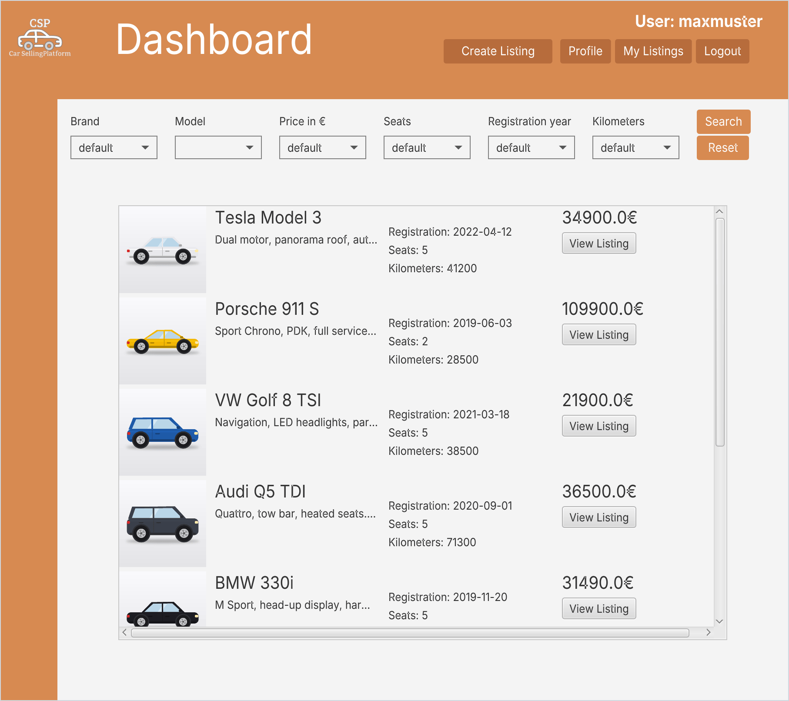
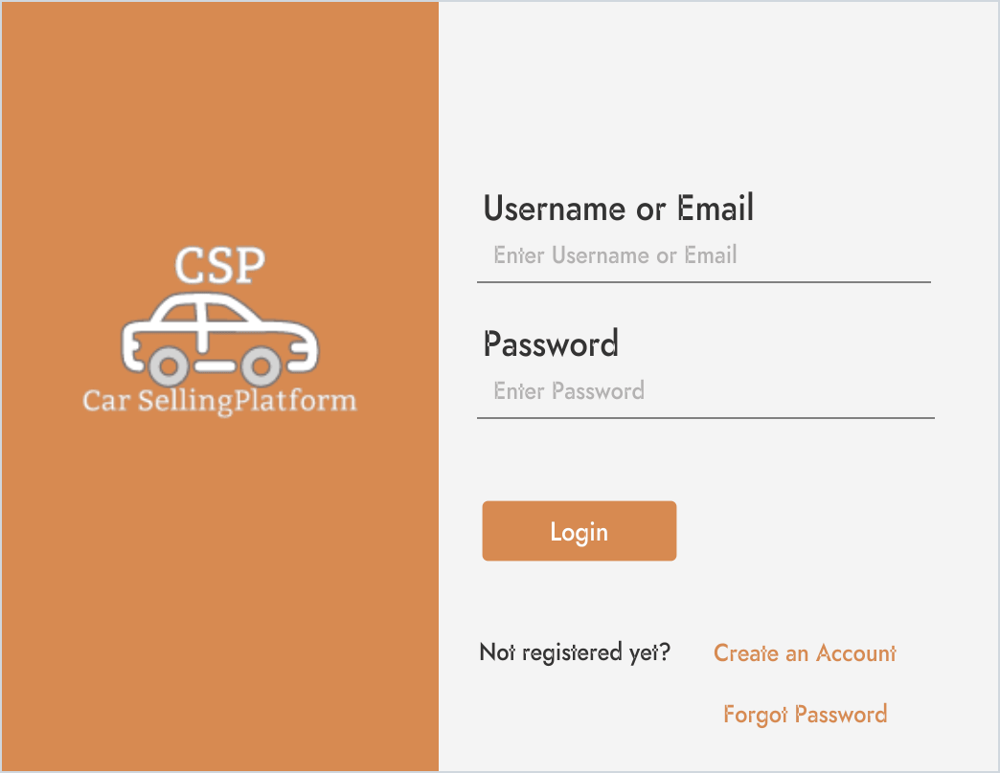
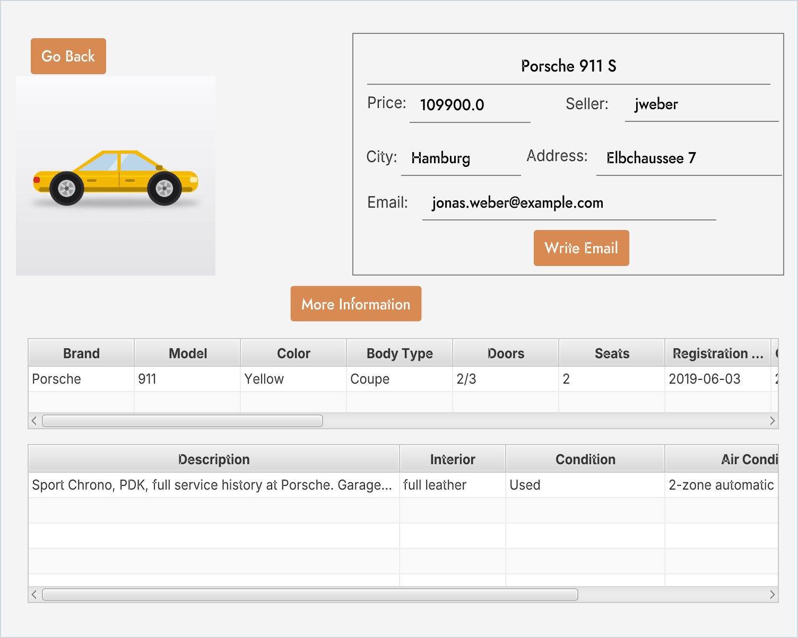
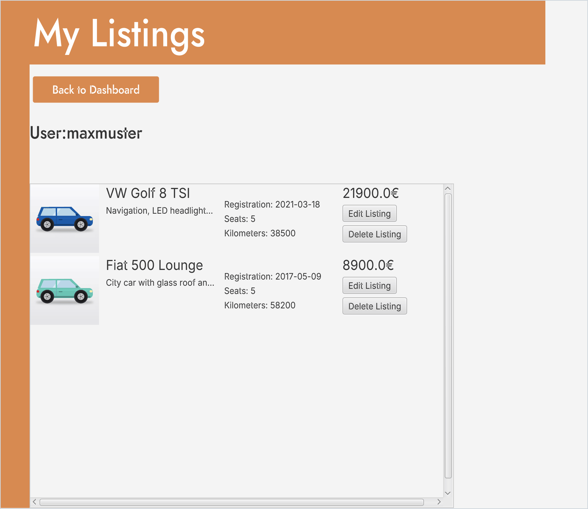
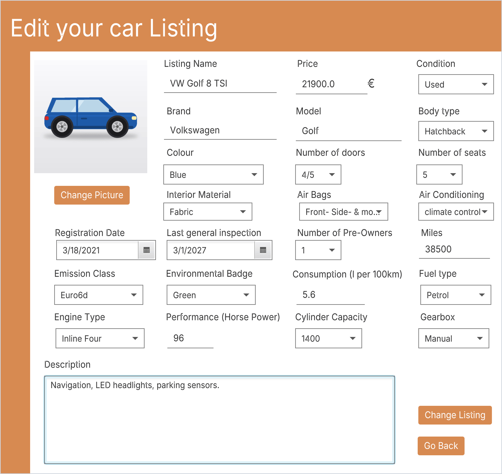

# CarSellingPlatform

Eine JavaFX-Desktop-Anwendung zum Kaufen und Verkaufen von Autos. Nutzer legen ein Konto an, stellen ihre Autos mit allen wichtigen Daten ein, durchsuchen die Inserate anderer mit Filtern und schreiben Verkäufern direkt aus der App eine E-Mail.

Entstanden als Gruppenprojekt mit vier Personen im Modul „Programming Exercises“ im Sommersemester 2023.

<p align="center">
  
</p>

## Funktionen

- **Konto:** Registrierung, Login, Profil bearbeiten und Konto löschen. Passwörter werden mit Salt gehasht gespeichert.
- **Passwort vergessen:** Ein Einmal-Code kommt per E-Mail, danach lässt sich ein neues Passwort setzen.
- **Inserate:** Autos mit ausführlichen Angaben einstellen, bearbeiten und löschen, zum Beispiel Marke, Modell, Farbe, Karosserie, Türen, Sitze, Airbags, Erstzulassung, HU und Kraftstoff.
- **Suche:** Inserate nach Marke, Modell, Preis, Sitzen, Erstzulassung und Kilometerstand filtern.
- **Kontakt:** Verkäufern direkt aus der App eine E-Mail schreiben.
- **Benachrichtigungen:** E-Mails bei Registrierung, Passwortänderung und Kontolöschung.

## Screenshots

<table>
  <tr>
    <td width="50%" align="center"><br><sub>Login</sub></td>
    <td width="50%" align="center"><br><sub>Inserat mit Verkäuferkontakt und technischen Daten</sub></td>
  </tr>
  <tr>
    <td width="50%" align="center"><br><sub>Eigene Inserate verwalten</sub></td>
    <td width="50%" align="center"><br><sub>Inserat bearbeiten</sub></td>
  </tr>
</table>

Die Screenshots zeigen Beispieldaten, die Autobilder sind Platzhalter-Grafiken.

## Technik

Java, JavaFX mit FXML, MySQL über JDBC, JavaMail, Maven

Die ausführliche Projektdokumentation mit Anforderungen, ER-Modell sowie UML-, Aktivitäts- und Sequenzdiagrammen liegt in [Doku.pdf](Doku.pdf) (Englisch). Das Klassendiagramm gibt es zusätzlich als [all.png](all.png).

## Starten

Voraussetzungen sind ein JDK ab Version 17, eine MySQL-Datenbank und ein E-Mail-Konto mit SMTP-Zugang. Im Projekt war GMX eingestellt (`mail.gmx.net` in `Mail.java`).

1. Eine Datenbank anlegen und das Schema aus [`schema.sql`](schema.sql) importieren.
2. Die Datei `src/main/resources/com/example/carsellingplatform/config.properties` anlegen. Sie steht in der `.gitignore` und wird nicht mit hochgeladen.
   ```properties
   database.url=jdbc:mysql://localhost:3306/carsellingplatform
   database.user=<benutzer>
   database.password=<passwort>
   email.username=<mail-adresse>
   email.password=<mail-passwort>
   ```
3. Die Anwendung mit dem Maven Wrapper starten:
   ```bash
   ./mvnw clean javafx:run
   ```
   Unter Windows heißt der Befehl `mvnw.cmd clean javafx:run`.
